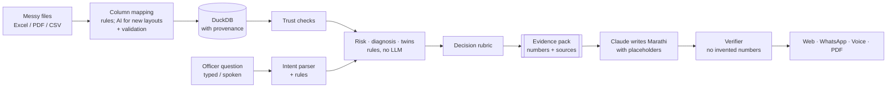

# Kaaran (कारण): an AI data analyst for education officers

> **Existing systems give officers data. Kaaran gives them a data analyst.**
>
> AI for Foundational Learning Hackathon (ShikshaNext × Anthropic), Challenge 4 "Data to Action",
> sub-problem 1. Team EASY COMPANY.

**The problem.** A Block Education Officer (BEO) in Maharashtra looks after 150-300 schools in 10-20 clusters
(kendras). Data arrives every month (UDISE+, attendance, teacher posts, assessment rounds), but it sits in
separate portals and Excel sheets. Nobody joins it, nobody checks if it can be trusted, and the review meeting
ends with generic instructions. The gap is not data; it is the step from data to a **specific, trusted, doable
action**.

**Kaaran.** An officer asks in Marathi or English (typed or spoken, on the web or WhatsApp). Kaaran gives a
**direct answer computed by code**, **kendra cards** (what happened / why, with a rule-based confidence label /
what to do, with owner and timing) and a **one-page evidence brief (PDF)** in which every figure links to its
source file, sheet and rows. Claude reads the question and writes the Marathi; it never produces a number.

> ⚠️ **All demo data is SYNTHETIC** (generated, marked in every file, page, reply and PDF). It copies the formats
> of real systems (UDISE+ microdata columns, state-style exports). No real school or person is described.

---

## Live demo

| | |
|---|---|
| Web app | **https://kaaran.onrender.com** (TODO: confirm the URL after deploy, see [docs/DEPLOY.md](docs/DEPLOY.md); free plan, first visit after a quiet spell can take ~15 s) |
| WhatsApp simulator | **https://kaaran.onrender.com/whatsapp** (TODO: confirm) |
| Source | https://github.com/DurgeshC16/Kaaran |

The demo runs on Render's free plan (512 MB RAM, 0.1 CPU), which puts the service to sleep after 15 minutes
without visits. The synthetic data, briefs, one-page PDFs and a prepared-state cache are all built into the image
(`python -m kaaran.warm`), so a woken service is up in about 15 s and gives its first answer in about 16 s (measured
locally with `docker run --memory=512m --cpus=0.1`); after that, answers come back in under a second. A free uptime
monitor keeps it awake during evaluation (docs/DEPLOY.md). The host loads only the main dataset (`KAARAN_DATASETS=blocks`).

## Try it in 2 minutes

No login and nothing to install.

1. Open the web app. On the home page **pick a role**: **DEO** (district view: every block, the blocks that need
   attention) or **BEO** (block view: my kendras).
2. Type or click one of the questions below (or press 🎤 and speak, if voice is switched on).
3. Click any **blue number** to see where it came from (file, sheet/table, filter, rows).
4. Press the button for the **full evidence / brief** and download the one-page **PDF**.
5. Open **/whatsapp**. It is a WhatsApp simulator that runs the same bot code as the real WhatsApp webhook.

Best sample inputs. These are regression tests (`tests/test_officer_questions.py`, `tests/test_answers.py`), and
the answers below are the output on the demo dataset (seed 42).

| Ask | What you should get |
|---|---|
| `Which block needs most attention?` | "Most attention needed: Pandharpur (3 clusters), Karmala (1 cluster), Madha (1 cluster)", then a card for each kendra in Pandharpur (what / why with label / what to do with owner). The full brief is behind a button. |
| `Malshiras cha nikal changla ka aala?` (why did Malshiras improve?) | Reply in Marathi: maths rose 2.7 points to 65.2%, the kendras that rose most (Longaon Khurd +5.0, Malner Budruk +4.3), and, because teachers, attendance and visits stayed about the same, "the data shows no clear reason; ask the clusters that rose most what they did differently". It never invents a cause. |
| `पंढरपूर मध्ये किती शाळा आहेत?` | One line: "पंढरपूरमध्ये १४० शाळा आहेत (१२ केंद्रे)." Click १४० to see the source file. |
| `pandharpoor madhe kiti shala ahet, karmala PTR kiti, mohol la shikshak kiti kami.` (misspelt, 3 questions) | Three answers, one per part: schools in Pandharpur, PTR in Karmala (26.5; 2 schools above 30), vacant posts in Mohol. |
| `Which teacher in Pandharpur is absent most often?` | Refused: Kaaran never answers about individual teachers or students. |

More to try: `how many schools are there in solapur` (district totals), `Which of madha attendance records look
unreliable?` (data-quality answer: the kendra, why its records are excluded, and "check the registers in person"),
`What about Bhalwad Khurd kendra?` (one kendra's card), `निकाल का घसरला?` (asks *which taluka*; your reply
finishes the question), `hello` (help with examples).

## Test credentials for every role

**There is no login in the demo.** Nobody needs a username or password.

| Role | How to get it |
|---|---|
| District Education Officer (DEO) | Choose **DEO** on the home page: district picture, blocks that need attention, all blocks. |
| Block Education Officer (BEO) | Choose **BEO** on the home page and pick a block: that block's kendras as cards. |
| WhatsApp user | Use the built-in simulator at **/whatsapp**. It runs the same `Bot` code as the real webhook. |

The real WhatsApp number is a Meta **test number**. Meta only lets it message phone numbers that are registered on
it in advance, so evaluators should use the simulator. If you want to see the real WhatsApp flow, send your number
to the team and we will register it (setup: [docs/DEPLOY.md](docs/DEPLOY.md)).

---

## What makes it different

| | Dashboards | Chat-with-data LLMs | **Kaaran** |
|---|---|---|---|
| Checks whether data can be trusted before drawing conclusions | ✗ | ✗ | ✅ rule-based, reported |
| Explains *why* with fixed, published tests | ✗ | improvised | ✅ |
| Actions grounded in constraints, with owner and timing | ✗ | generic | ✅ decision rubric |
| Every number traceable to file / sheet / row | partly | ✗ | ✅ click to source |
| Numbers can be invented by AI | n/a | yes | **no, by design and by test** |
| Marathi, voice, WhatsApp, low bandwidth | rarely | partly | ✅ |
| Starts without a question (alerts when data arrives) | ✗ | ✗ | ✅ district scan, no LLM |

## Architecture (layers)

1. **Data input.** Messy Excel / CSV / PDF exports in real formats are loaded into DuckDB with provenance on every
   row. For an unfamiliar layout, Claude proposes the column mapping from headers and masked sample values, and
   code validates it against a closed vocabulary (`ingest(..., proposer="llm")` in `kaaran.ingest.pipeline`, run by `kaaran.eval --proposer llm` and `kaaran.eval.mapping`; evaluated on the
   taluka-lens file set). The block-lens demo files are read by a bilingual rule-based header recogniser
   (`block/ingest.py`); wiring the AI mapper into it is a next step.
2. **Trust checks.** Rules find flat 100% attendance runs, sudden jumps, missing schools, duplicates and
   implausible combinations. Flagged records are excluded and reported, never silently dropped. Honest
   low-attendance schools are explicitly cleared.
3. **Analysis engines (no LLM).** pandas / numpy / DuckDB: risk scan per kendra, differential diagnosis D1-D8
   (staffing, support visits, absence, migration, duty, data, competency), positive deviants, twin block.
   Confidence labels (STRONG / WEAK / INSUFFICIENT) come from written rules
   ([docs/CONFIDENCE_RULES.md](docs/CONFIDENCE_RULES.md)).
4. **Decision rubric.** Situation + constraints → action, owner, deadline and follow-up metric
   (`src/kaaran/block/rubric_v1.json`, actions A1-A13). Seven actions are linked to Samagra Shiksha PAB 2026-27
   line items. The LLM never chooses an action.
5. **Question understanding.** Claude (light model) turns the question into a validated plan. Rules handle
   greetings, counts, rankings, multi-part questions, follow-ups and refusals, and take over when the API is off.
6. **LLM wording with placeholders.** Claude (main model) writes Marathi/English sentences with `{{n:id}}`
   placeholders. Code fills in every figure from the evidence pack. Direct answers use fixed templates, with no
   LLM at all.
7. **Verifier.** It rejects any digit, spelled-out number, unknown placeholder, school name or causal word outside a
   STRONG finding. It retries once, then falls back to a template brief.
8. **Output.** Web (role homes, cards, click-to-source, school drill-down kept local), WhatsApp (text, PDF,
   MP3), voice (Sarvam STT/TTS), and a one-page A4 PDF via headless Chromium/Edge.



## Guardrails

1. **No invented numbers.** Every figure is computed in Python and carries provenance (file, sheet/page,
   rows or query). The verifier blocks numbers in LLM text; `kaaran.eval.brief` counts invented numbers (0).
2. **Labels from rules.** Causal wording is allowed only when all four STRONG criteria pass (effect, share,
   replication, no pre-trend). Everywhere else the text says "associated with".
3. **Trust before analysis.** Unreliable records are flagged, excluded and named in the answer, with the action
   "check the registers".
4. **Privacy.** Only aggregates reach the LLM. School names never appear in generated text, and school lists
   appear only in the local drill-down. Questions about individual teachers or students are refused.
5. **Clarify, don't guess.** Ambiguous or missing places get a question back, and the officer's reply completes
   the original question (web, voice and WhatsApp).
6. **Scope.** Off-topic questions (weather, cricket, today's date) are refused politely.
7. **Prompt injection.** File contents reach the model only as masked, quoted summaries
   (`python -m kaaran.eval.guardrails`).
8. **Cost caps.** Hard per-process spend caps for Claude (`KAARAN_MAX_LIVE_USD`) and Sarvam
   (`KAARAN_MAX_VOICE_INR`). Errors shown to officers use fixed bilingual reasons, never raw API text.
9. **Webhook security.** WhatsApp POSTs need a valid `X-Hub-Signature-256`. Message ids are de-duplicated.

## Offline and low-connectivity behaviour

| If this is missing | Kaaran still… |
|---|---|
| Internet / Anthropic API | answers from recorded responses (`llm_cache/`, `KAARAN_LLM_MODE=replay`). New wordings go to the rule-based question reader. |
| A verified LLM brief | uses the **template brief** (same figures, labels and actions). |
| Voice (no Sarvam key or bad network) | works by text. The 🎤/🔊 buttons are hidden and WhatsApp asks the officer to type. |
| Headless browser for PDF | serves the print view `/api/briefs/<id>/print`, which any browser can print. |
| Bandwidth | sends short answers first. The PDF is one A4 page, the voice summary is about one minute of MP3, and the web page loads no external resources. |

All analysis, alerts, rankings, direct answers and actions are computed locally, with no AI call and no cost.

---

## Run it locally

Requires Python 3.11+. Optional: Microsoft Edge, Chrome or Chromium for the PDF.

**Windows**

```bat
py -3.11 -m venv .venv
.venv\Scripts\python -m pip install -e .[dev]
copy .env.example .env
.venv\Scripts\python -m kaaran.api
```

**Linux / macOS**

```bash
python3.11 -m venv .venv
.venv/bin/python -m pip install -e ".[dev]"
cp .env.example .env
.venv/bin/python -m kaaran.api
# macOS PDF: export KAARAN_BROWSER="/Applications/Google Chrome.app/Contents/MacOS/Google Chrome"
```

Open http://127.0.0.1:8000 (web) and http://127.0.0.1:8000/whatsapp (simulator). The synthetic demo datasets are
generated on first start. With the default `.env` (replay mode, no keys) everything runs offline at no cost.

**Docker**

```bash
docker build -t kaaran .
docker run -p 8000:8000 kaaran                                    # offline replay, no keys
docker run -p 8000:8000 --env-file .env kaaran                    # with your keys
```

The image has Chromium and Noto fonts (for Devanagari PDFs). Secrets come from the environment only.
`.dockerignore` keeps `.env` and `data/` out of the image.

Public deploy (Render free plan, render.yaml; Hugging Face Spaces with PRO as an alternative) and the real WhatsApp number: [docs/DEPLOY.md](docs/DEPLOY.md).
Demo script and WhatsApp details: [docs/DEMO.md](docs/DEMO.md).

## Configuration (`.env.example`)

Copy it to `.env` (git-ignored, never commit it). Settings resolve in this order: environment, then `.env`, then
`.env.example`.

| Variable | Default | Meaning |
|---|---|---|
| `ANTHROPIC_API_KEY` | empty | Claude key. Needed only for `KAARAN_LLM_MODE=live`. |
| `KAARAN_MODEL_MAIN` | `claude-sonnet-5-5` | Main model: column mapping and brief wording. Never hard-coded in code. |
| `KAARAN_MODEL_LIGHT` | `claude-haiku-5-5` | Light model: reading the officer's question (intent). |
| `KAARAN_ENV` | `dev` | Label only; not read by the code. |
| `KAARAN_LLM_MODE` | `replay` | `replay` = recorded responses only (offline, free); `live` = recorded first, then the API (records new responses); `off` = no LLM, rule and template fallbacks. |
| `KAARAN_DEMO_DATASET` | `blocks` | Dataset the web/WhatsApp demo opens with: `blocks`, `blocks_fictional` (cluster lens), `solapur`, `fictional` (older taluka lens). |
| `KAARAN_DATASETS` | all four | Comma-separated list of datasets to load. The Render free plan uses `blocks` only (about 210 MB instead of about 630 MB). |
| `KAARAN_BROWSER` | empty | Path to Edge/Chrome/Chromium for PDFs. Empty = auto-detect. |
| `WHATSAPP_TOKEN` | empty | Meta Cloud API access token (system-user token for a lasting deploy). |
| `WHATSAPP_PHONE_NUMBER_ID` | empty | Phone number id of the WhatsApp (test) number. |
| `WHATSAPP_VERIFY_TOKEN` | empty | Any random string. Meta sends it back when you verify the webhook. |
| `WHATSAPP_APP_SECRET` | empty | Meta app secret. Without it every webhook POST is rejected (no unsigned mode). |
| `WHATSAPP_GRAPH_VERSION` | `v26.0` | Graph API version. |
| `SARVAM_API_KEY` | empty | Sarvam AI key for voice. Empty = voice off, text still works. |
| `KAARAN_STT_MODEL` | `saaras:v4` | Sarvam speech-to-text model. |
| `KAARAN_TTS_MODEL` | `bulbul:v4-flash` | Sarvam text-to-speech model. |
| `KAARAN_TTS_SPEAKER_MR` / `_EN` | `ritu_mr_narration` / `ritu_en_edtech` | Voices for Marathi and English summaries. |
| `KAARAN_TTS_PACE` | `1.0` | Speaking pace. |

Not in `.env.example`, but read by the code:

| Variable | Default | Meaning |
|---|---|---|
| `KAARAN_MAX_LIVE_USD` | `15` | Per-process Claude spend cap. Further live calls are refused. |
| `KAARAN_MAX_VOICE_INR` | `100` | Per-process Sarvam spend cap. |
| `KAARAN_VOICE` | `on` | `off` switches voice off (tests do this). |
| `KAARAN_VOICE_REPLY` | `on` | `off` stops the MP3 voice summary on WhatsApp. |
| `KAARAN_HOST` / `PORT` | `127.0.0.1` / `8000` | Server bind address and port (Docker sets `0.0.0.0`). |
| `KAARAN_BROWSER_NO_SANDBOX` | unset | `1` adds Chromium `--no-sandbox` (set in Docker). |
| `KAARAN_LLM_CACHE`, `KAARAN_LLM_USAGE_LOG`, `KAARAN_VOICE_CACHE`, `KAARAN_VOICE_USAGE_LOG` | `llm_cache/`, `data/…` | Where recordings, audio and usage logs are kept. |

## External AI services and where keys are needed

Every call that leaves the machine is listed here. Without any key, the demo still runs end to end (replay
mode, text only, simulator).

| Service | What Kaaran uses it for | Models / endpoint | Key / settings | What is sent | Guard |
|---|---|---|---|---|---|
| **Anthropic Claude** | (1) **intent parser**: question → validated plan; (2) **column mapper** (Messy-File Reader): proposes column mapping for unfamiliar file layouts (`proposer="llm"` in `kaaran.ingest.pipeline`, run by `kaaran.eval --proposer llm`; not yet used by the block-lens demo ingest); (3) **brief writer**: Marathi/English wording with placeholders | light: `KAARAN_MODEL_LIGHT` (intent); main: `KAARAN_MODEL_MAIN` (mapping, writing) | `ANTHROPIC_API_KEY`; `KAARAN_LLM_MODE` = `replay` / `live` / `off`; cap `KAARAN_MAX_LIVE_USD` (default 15) | the question; headers + masked low-cardinality values; aggregate evidence (no school names, no numbers to copy: placeholders only) | code-validated plans and mappings, verifier, retry then template, replay cache, usage log |
| **Sarvam AI** | **speech-to-text** for spoken questions (web mic, WhatsApp voice notes, language auto-detected); **text-to-speech** for the one-minute voice summary | STT `saaras:v4` (`POST https://api.sarvam.ai/speech-to-text`); TTS `bulbul:v4-flash` (`POST https://api.sarvam.ai/text-to-speech`, MP3) | `SARVAM_API_KEY`; `KAARAN_STT_MODEL`, `KAARAN_TTS_MODEL`, `KAARAN_TTS_SPEAKER_MR/_EN`; cap `KAARAN_MAX_VOICE_INR` (default 100) | the recording (to transcribe only); the spoken script (aggregates, no school names) | audio cached by text hash, usage log, fixed error reasons |
| **Meta WhatsApp Cloud API** (not AI, but external) | receive officer messages and voice notes; send text, PDF (document) and MP3 replies | Graph `WHATSAPP_GRAPH_VERSION` (v26.0) | `WHATSAPP_TOKEN`, `WHATSAPP_PHONE_NUMBER_ID`, `WHATSAPP_VERIFY_TOKEN`, `WHATSAPP_APP_SECRET` | block/kendra-level replies (synthetic data in the demo) | HMAC signature check, de-duplication, masked event log |
| **Headless Chromium / Edge** (local, no network) | renders the one-page A4 PDF with correct Devanagari shaping | the installed browser | `KAARAN_BROWSER` (optional), `KAARAN_BROWSER_NO_SANDBOX` | nothing leaves the machine | 503 + print view if missing |

Recorded Claude responses for all demo questions and briefs are committed in `llm_cache/` (synthetic inputs only),
so tests, evals and the public demo replay at no cost.

## Tests and evaluations

```bat
.venv\Scripts\python -m pytest -q -m "not slow"          :: fast tests (everyday)
.venv\Scripts\python -m pytest -q                        :: full suite (before every commit)
.venv\Scripts\python -m pytest -q --live -m live         :: live Claude tests (cost money, opt-in)
.venv\Scripts\python -m kaaran.eval.block --seed 42      :: block-lens scorecard (risks, diagnoses, actions vs truth3.json)
.venv\Scripts\python -m kaaran.eval --seed 42            :: taluka-lens scorecard vs answer key
.venv\Scripts\python -m kaaran.eval.intent --tier light --tier main --tier rule   :: 25-question intent eval
.venv\Scripts\python -m kaaran.eval.brief --seed 42      :: verifier pass, invented numbers, cost
.venv\Scripts\python -m kaaran.eval.mapping --seed 42    :: column mapping, baseline vs LLM, both layouts
.venv\Scripts\python -m kaaran.eval.guardrails           :: prompt-injection check
```

Linux/macOS: use `.venv/bin/python` instead of `.venv\Scripts\python`. Tests never call Sarvam
(`KAARAN_VOICE=off`) and replay Claude from `llm_cache/`.

Current numbers (from [PROGRESS.md](PROGRESS.md) and [docs/09_PROGRESS_REPORT.md](docs/09_PROGRESS_REPORT.md)):
- 295 tests (252 in the fast suite): full run on 2026-10-31 (replay mode, voice off): 292 passed, 3 skipped (the
  live-API tests, which run only with `--live`).
- Block-lens scorecard: 19/19 on seeds 42, 7, 99, 2026, 11 and 77.
- Taluka-lens scorecard: 8/8 planted truths on 5 seeds.
- Invented numbers in briefs: 0.
- Column mapping on an unseen layout: 100%.
- Intent accuracy (25 questions): light model 92%, rule tier 96%.

Step-by-step manual test guide: [docs/10_TESTING_GUIDE.md](docs/10_TESTING_GUIDE.md). User testing log:
[docs/USER_TESTING.md](docs/USER_TESTING.md).

## Repository map

```
src/kaaran/
  synth/ synth3/   synthetic generators + answer keys (no LLM, deterministic per seed); synth3 = block -> kendra -> school, real formats
  ingest/ trust/   raw files -> DuckDB with provenance; trust rules (taluka lens)
  block/           block lens: ingest, trust, insights (risk + D1-D8), rubric.py + rubric_v1.json, pack, brief,
                   answers.py (direct answers by template), workspace.py, view.py
  causes/ twins/ confidence.py analyze.py evidence.py   taluka-lens engines and the evidence-pack contract
  llm/             Claude wrapper (replay cache, usage log, spend cap), file summaries, column mapper, intent parser
  brief/           brief writer, verifier, Marathi/English texts, HTML and PDF rendering
  voice/           Sarvam STT/TTS client and the one-minute spoken script
  real/            real public data: UDISE+ validation, aggregate block snapshot, PAB citation check
  service.py       question -> clarify | refuse | answer + cards + brief
  whatsapp.py      WhatsApp bot, Cloud API client, webhook signature + de-duplication
  api/             FastAPI app, web pages (/, /whatsapp, /real)
  eval/            scorecards against the answer keys
tests/             pytest suites
llm_cache/         recorded Claude responses (synthetic inputs only)
docs/              vision, data strategy, literature, SRS, architecture, rubrics, roadmap, testing, deploy
Dockerfile         demo image (Python 3.11-slim + Chromium + Noto fonts)
```

## Documentation

| Doc | What it covers |
|---|---|
| [01 Vision and rethink](docs/01_VISION_AND_RETHINK.md) | problem, users, mentor feedback, what changed in v2, what we will not do |
| [02 Data strategy](docs/02_DATA_STRATEGY.md) | data availability matrix, real vs synthetic, UDISE+ microdata schema |
| [03 Literature survey](docs/03_LITERATURE_SURVEY.md) | related systems and research, novelty claim |
| [04 SRS](docs/04_SRS.md) | users, use cases, requirements, acceptance criteria |
| [05 Architecture](docs/05_ARCHITECTURE.md) | architecture, flows, scalability, security, failure modes |
| [06 Decision rubrics](docs/06_DECISION_RUBRICS.md) | risk rules, differential diagnosis, action matrix, validation plan |
| [07 Roadmap and phases](docs/07_ROADMAP_AND_PHASES.md) | plan, decisions, post-hackathon pilot, risks |
| [08 Data download guide](docs/08_DATA_DOWNLOAD_GUIDE.md) | where to get each real dataset |
| [09 Progress report](docs/09_PROGRESS_REPORT.md) | what is built, real-data findings, quality numbers |
| [10 Testing guide](docs/10_TESTING_GUIDE.md) | how to run and test everything, step by step |
| [User testing](docs/USER_TESTING.md) | test rounds, feedback, what we changed, pilot protocol |
| [Deploy](docs/DEPLOY.md) | Render (free) / Hugging Face Spaces, Meta WhatsApp setup, webhook checker, smoke tests |
| [Demo](docs/DEMO.md) · [Evidence schema](docs/EVIDENCE_SCHEMA.md) · [Confidence rules](docs/CONFIDENCE_RULES.md) · [Synthetic data spec](docs/SYNTHETIC_DATA_SPEC.md) | demo script and technical contracts |

## Data note

- **Demo data is synthetic** and marked SYNTHETIC in every file, page, reply, voice script and PDF. The block-lens
  demo (`blocks`) is seed 42 of `kaaran.synth3`: 11 blocks, 109 kendras, 1,292 schools, with planted scenarios
  and an answer key (`truth3.json`). Real Solapur block names are used as labels only. `blocks_fictional` uses
  invented names.
- **Real public data** (UDISE+ 2024-25 microdata for Solapur, PARAKH PRS 2024 benchmarks, AIKosh 2019-20, PAB
  2026-27) is processed locally by `python -m kaaran.real` into **aggregates only** (the `/real` page). The files
  live in `data/real/`, which is git-ignored and never committed or copied into the Docker image. Tests use fake
  files in the real format. Because of this, `/real` shows the snapshot only where the aggregate file exists: on a
  machine where `python -m kaaran.real` has been run, or on the hosted demo when the aggregate `real_snapshot.json`
  (block totals, no school identifiers) is uploaded as a Render Secret File (docs/DEPLOY.md, step 7). Without it the
  page says that no real-data snapshot is available.
  The figures are summarised in [docs/09_PROGRESS_REPORT.md](docs/09_PROGRESS_REPORT.md) §3.
- Kaaran never ranks or names individual teachers or students and never claims a cause is proven. Actions are
  suggestions; the officer confirms before anything is forwarded.

## Licence

TODO: choose and add a licence (e.g. MIT or Apache-2.0) before open-sourcing. Until then, all rights reserved by
the team.
