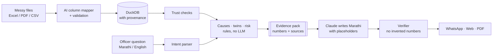

# Kaaran (कारण): an AI data analyst for education officers

> **Existing systems give officers data. Kaaran gives them a data analyst.**
>
> AI for Foundational Learning Hackathon (ShikshaNext × Anthropic), Challenge 4 "Data to Action",
> sub-problem 1. Team EASY COMPANY.

A Block Education Officer looks after 150-300 schools. When results fall, they need to know **where the
problem is, why it is happening, and what to do on Monday**. The data exists (UDISE+, state attendance and
assessment systems, Excel sheets), but it is scattered, messy, sometimes unreliable, and nobody has time
to analyse it.

Kaaran reads the files the office already has, **checks whether the data can be trusted**, finds the
clusters and schools that need attention, **tests possible reasons** (teacher shortage, weak academic
support, absence, migration, election duty, bad records), and recommends **specific actions within the
officer's powers**. Output is Marathi first, on WhatsApp and the web: a short summary, a one-page PDF
brief, and click-to-source for every number.

> ⚠️ **All demo data is SYNTHETIC** (generated, marked in every file and output). It mirrors the formats of
> real systems. Real public data (PARAKH 2024 district report, UDISE+ microdata format) is used as
> benchmarks and structure only. No real school is described.

---

## Why it is different

| | Dashboards | Chat-with-data LLMs | **Kaaran** |
|---|---|---|---|
| Checks data trust before conclusions | ✗ | ✗ | ✅ rule-based, reported |
| Explains *why* with fixed, published tests | ✗ | improvised | ✅ |
| Actions grounded in constraints, with owner and deadline | ✗ | generic | ✅ decision rubric |
| Every number traceable to file / sheet / row | partly | ✗ | ✅ click to source |
| Numbers can be invented by AI | n/a | yes | **no, by design and by test** |
| Marathi, WhatsApp, low-bandwidth | rarely | partly | ✅ |

The LLM (Claude) is used only for what language models are good at: understanding the officer's question,
mapping messy column names, and writing clear Marathi. **Every number is computed by code, every label
comes from a written rule, and a verifier checks every sentence.**

## How it works



## Status

| Phase | State |
|---|---|
| 1-3 · Synthetic data, deterministic engines, AI layers | ✅ 8/8 planted truths on 5 seeds, 0 false flags, 0 invented numbers |
| 4a · Web demo + WhatsApp bot | ✅ click-to-source, school lists, one-page PDF, signed webhook, simulator |
| **v2 (in progress, after mentor review)** | block → cluster lens, real UDISE+ formats, three-part brief (attention / why / what to do), decision rubric for actions, proactive alerts, review-meeting pack, voice. See [docs/01_VISION_AND_RETHINK.md](docs/01_VISION_AND_RETHINK.md) and [docs/07_ROADMAP_AND_PHASES.md](docs/07_ROADMAP_AND_PHASES.md) |

## Quick start (Windows)

```bash
py -3.11 -m venv .venv
.venv\Scripts\python -m pip install -e .[dev]
.venv\Scripts\python -m kaaran.api            # http://127.0.0.1:8000  (WhatsApp simulator: /whatsapp)
```

Demo datasets are generated automatically on first run. AI answers for the demo are recorded in
`llm_cache/`, so the demo runs **offline at no cost** (`KAARAN_LLM_MODE=replay`). Set
`KAARAN_LLM_MODE=live` and `ANTHROPIC_API_KEY` to send new questions to Claude. Details and the real
WhatsApp setup: [docs/DEMO.md](docs/DEMO.md).

Other commands:

```bash
.venv\Scripts\python -m pytest -q -m "not slow"                       # fast tests
.venv\Scripts\python -m pytest -q                                     # full suite
.venv\Scripts\python -m kaaran.synth --seed 42 --out data/synthetic/demo
.venv\Scripts\python -m kaaran.analyze data/synthetic/demo/raw --focus Pandharpur --out evidence.json
.venv\Scripts\python -m kaaran.brief data/synthetic/demo/raw --focus Pandharpur --out-dir out
.venv\Scripts\python -m kaaran.eval --seed 42                         # scorecard vs answer key
```

## Guardrails

1. **No invented numbers.** Claude writes `{{n:id}}` placeholders; code fills the values. A verifier rejects
   any digit, spelled-out number or unknown placeholder, retries once, then falls back to templates.
2. **Labels from rules.** STRONG / WEAK / INSUFFICIENT come from published thresholds
   ([docs/CONFIDENCE_RULES.md](docs/CONFIDENCE_RULES.md)). Causal words are allowed only when all four
   STRONG criteria pass (effect, share of decline, replication, timing).
3. **Trust before analysis.** Implausible records are flagged, excluded from analysis and reported; honest
   low-attendance schools are explicitly cleared.
4. **Privacy.** Only aggregates go to the LLM; school names never appear in generated text.
5. **Clarify, don't guess; refuse what is out of bounds.** Unknown or ambiguous places get a question back;
   requests to rank or name teachers or students are refused.
6. **Prompt-injection resistant.** File contents reach the model only as masked, quoted summaries (tested).
7. **Graceful degradation.** No API → rule-based intent + template brief; no browser → HTML print view.

## Documentation

| Doc | What it covers |
|---|---|
| [01 Vision and rethink](docs/01_VISION_AND_RETHINK.md) | problem, users, mentor feedback, what changed in v2, what we will not do |
| [02 Data strategy](docs/02_DATA_STRATEGY.md) | data availability matrix, real vs synthetic, UDISE+ microdata schema, data model v2 |
| [03 Literature survey](docs/03_LITERATURE_SURVEY.md) | related systems and research, comparison, novelty claim, references |
| [04 SRS](docs/04_SRS.md) | users, use cases, functional and non-functional requirements, acceptance criteria |
| [05 Architecture](docs/05_ARCHITECTURE.md) | target architecture, flows, scalability, tech stack, security, failure modes |
| [06 Decision rubrics](docs/06_DECISION_RUBRICS.md) | risk rules, differential diagnosis, action matrix with constraints, validation plan |
| [07 Roadmap and phases](docs/07_ROADMAP_AND_PHASES.md) | done, plan to submission, decisions, post-hackathon pilot, risks |
| [08 Data download guide](docs/08_DATA_DOWNLOAD_GUIDE.md) | where to get each real dataset and where to put it |
| [Evidence schema](docs/EVIDENCE_SCHEMA.md) · [Confidence rules](docs/CONFIDENCE_RULES.md) · [Synthetic data spec](docs/SYNTHETIC_DATA_SPEC.md) · [Demo](docs/DEMO.md) | technical contracts and how to run |

## Repository layout

```
src/kaaran/
  synth/      synthetic district generator + answer key (no LLM, deterministic per seed)
  ingest/     raw files → DuckDB with provenance (rule + AI column mapping)
  trust/      data-quality rules
  causes/ twins/ confidence.py analyze.py   deterministic analysis → evidence pack
  llm/        Claude wrapper (replay cache, cost cap), file summaries, mapper, intent parser
  brief/      Marathi/English writer, verifier, HTML/PDF rendering
  service.py  question → clarify | refuse | brief
  whatsapp.py WhatsApp Cloud API bot
  api/        FastAPI app + web pages
  eval/       scorecards against the answer key
tests/        pytest suites (203 tests)
llm_cache/    recorded AI responses (synthetic inputs only) for offline demos and tests
docs/         specifications and plans
```

## Tech stack

Python 3.11 · pandas · numpy · DuckDB · openpyxl · pypdfium2 · FastAPI · Anthropic SDK (Claude Sonnet for
mapping and writing, Claude Haiku for intent; model ids from environment variables) · headless Chromium
for Devanagari PDF · WhatsApp Cloud API · pytest. Planned: pluggable Marathi speech (AI4Bharat / Bodhan AI
open models), PostgreSQL and a job queue for pilot scale ([docs/05_ARCHITECTURE.md](docs/05_ARCHITECTURE.md)).

## Data and ethics

- Demo data is synthetic and marked SYNTHETIC everywhere. Real data is never committed (`data/real/` is
  git-ignored).
- Kaaran never ranks or names individual teachers or students, and never claims a cause is proven.
- Recommended actions are suggestions; the officer confirms before anything is forwarded.
