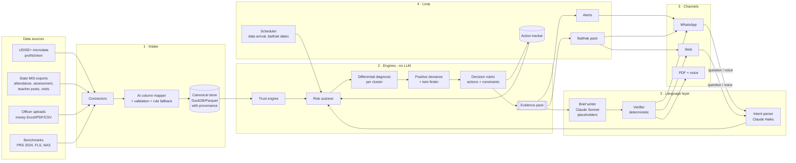

# 05 · Architecture v2: from data arrival to an action in the review meeting

> Builds on the working v1 (Phases 1-4). Shows the target design, what changes in code, how it scales
> from one block to a state, and the tech stack with reasons. Requirements: 04_SRS.md. Rules: 06.

---

## 1. Design principles

1. **Code computes, rules decide, the LLM only talks.** Numbers, labels and actions come from code and
   versioned rule tables. The LLM reads questions, maps messy columns and writes Marathi. A verifier
   checks every sentence.
2. **One contract in the middle.** All engines write an **evidence pack**; all outputs read it. Engines and
   channels evolve independently and are tested separately.
3. **System-triggered first, question-driven second.** New data starts a scan; questions reuse the same
   packs.
4. **Config over code for anything state-specific:** column mappings, thresholds, rubric, texts.
5. **Degrade, never break:** no LLM → templates; no browser → HTML; no voice → text; bad data → flagged.
6. **Local by default:** identifiable data stays on the server; only aggregates go to external models.

## 2. The whole system

## 3. Layers in detail

### 3.1 Intake (built; extended)
- **Connectors:** `udise_microdata` (new: reads `prof1/prof2/tch/enr1/fac`), `state_exports` (attendance,
  assessment, posts, visits, training), `uploads` (any messy file), `benchmarks` (PRS/FLS/NAS tables,
  entered once with page references and checked against a rendered page image).
- **Mapping:** rule baseline + Claude proposer over **masked file summaries** (headers and low-variety
  values only), validated against a closed vocabulary and a dry-run parse; retry once with error codes;
  else rules. Built and evaluated (100% on a hold-out layout).
- **Canonical store:** DuckDB file per district (+ Parquet snapshots), tables in 02 §5, each row with
  `src_file, src_sheet_or_page, src_row`. Ingest report: fixes, unresolved rows, sources with SHA-256.

### 3.2 Engines (all deterministic, all testable alone)
| Engine | Input | Output (findings in the pack) | Status |
|---|---|---|---|
| Trust | canonical tables | RED_FLAG / INSUFFICIENT / CLEARED findings + exclusion list | ✅ (+ new rules in 02 §7) |
| Risk scanner | trusted tables | RISK findings: at-risk clusters and schools, ranked, with the metric that triggered them | ⏳ new |
| Differential diagnosis | at-risk units | DIAGNOSIS findings per cluster: which rubric checks pass (staffing gap, support gap, absence, migration, duty, data problem), each with evidence strength | ⏳ (extends `causes/`) |
| Competency focus | assessment | weakest competencies per at-risk cluster vs block | ⏳ new |
| Positive deviance / twins | all units | LEARN_FROM schools inside the block; twin block for the DEO | 🟡 (twin taluka ✅) |
| Decision rubric | diagnoses + constraints | ACTION findings: action, owner, deadline, follow-up metric, rule id, rubric version | ⏳ (catalog ✅) |
| Outline | all findings | three sections A / B / C + appendix, by written rule | ⏳ (6-section ✅) |

### 3.3 Language layer (built)
- **Intent parser (Claude Haiku):** question → plan from closed lists (unit ids from the gazetteer, question
  type, metric); validator turns doubt into clarification. Rule fallback.
- **Brief writer (Claude Sonnet):** sees `llm_view(pack)` only (aggregates, no school names); writes per
  finding with `{{n:}} {{e:}} {{s:}} {{p:}}` placeholders. Code fills numbers (Devanagari digits), names,
  badges, owners, banner.
- **Verifier:** placeholders allowed per finding; no digits; no spelled numbers; causal words only for
  STRONG; no school names; required sections; Marathi script check. One retry, then templates.
- **Speech (new, pluggable):** `stt.transcribe(audio) → text + confidence`, `tts.speak(text) → ogg`.
  Providers: Bodhan AI / AI4Bharat models (self-hosted, open) or a hosted API. The voice summary is
  generated from the code-built summary, with numbers converted to Marathi words by code.

### 3.4 Loop (new)
- **Scheduler:** watches for new data (file drop / connector pull), runs the block scan, and creates alerts
  when risk crosses a threshold; generates the baithak pack N days before each block's review date.
- **Alerts:** WhatsApp template message (approved by Meta; required outside the 24-hour window) with a
  one-line summary and a link / reply keyword; web inbox entry.
- **Action tracker:** when the officer confirms an action, store it (owner, due date, metric, baseline);
  the next scan re-computes the metric and marks the action *done / no change / worse*; the baithak pack
  shows it.

### 3.5 Channels (built; extended)
FastAPI app: web UI (Marathi/English, click-to-source, school lists, downloads), WhatsApp webhook (signed,
de-duplicated) and simulator, PDF via headless Chromium. Added: alert inbox, baithak page, voice notes.

## 4. Two flows

**Flow 1: system-triggered (the scale path)**
1. The attendance export for October lands (connector or upload).
2. Ingest + trust run for the district (seconds).
3. The risk scanner scores every cluster in every block; two clusters in Pandharpur cross the threshold.
4. Diagnosis, positive deviance and the rubric run for those clusters; the evidence pack is built.
5. An alert goes to the Pandharpur BEO: "२ केंद्रांना लक्ष देण्याची गरज. कारणे आणि कृती पाहण्यासाठी 'अहवाल' लिहा."
6. The officer replies; the three-part brief (text + PDF + voice) arrives. They confirm two actions.
7. The actions appear in next week's baithak pack, assigned to two Kendra Pramukhs; next month's scan
   re-checks the metrics.

**Flow 2: question-driven (built, reused)**
Voice or text question → intent (clarify/refuse/plan) → cached or fresh pack → brief.

## 5. Scalability

| Scale | Data | Compute | LLM | Notes |
|---|---|---|---|---|
| Demo (one district, 11 blocks, ~1,300 schools) | DuckDB in memory | one process | replayed or live | today |
| Pilot (one district, real exports) | DuckDB file + Parquet snapshots per month | one small VM (2 vCPU, 4-8 GB) | ~$0.04 per brief | + Postgres for users/actions/audit |
| State (Maharashtra: ~1.08 lakh schools in UDISE+ 2024-25, ~350+ blocks) | Parquet partitioned by district/month; DuckDB per job | worker pool (job queue) | ~$0.04 × briefs; alerts use templates (no LLM) | analysis is per block, stateless, embarrassingly parallel |

Why this scales:
- **Per-block, stateless jobs.** A block scan reads one district partition and writes one pack. A state
  scan is a fan-out of independent jobs (queue + workers). Today a full district pack set takes ~2 s.
- **LLM cost is decoupled from scanning.** Scans, trust, diagnosis and actions are free (no LLM). The
  LLM writes prose only when a brief is opened; cached per pack hash; templates as fallback.
  Order of magnitude: 350 blocks × 4 briefs/month × $0.04 ≈ $56/month for a state.
- **Config per state.** Column mappings (validated JSON), thresholds, rubric and texts are data; a new
  state is a config pack + mapping run.
- **Model-agnostic language layer.** One wrapper (`llm/client.py`) with caching, cost caps and replay;
  swapping to an Indian or self-hosted model is a provider change plus re-running the eval.

## 6. Tech stack (now → pilot → state)

| Concern | Now (hackathon) | Pilot / state | Why |
|---|---|---|---|
| Language | Python 3.11 | same | data ecosystem; one language end to end |
| Data processing | pandas, numpy | + pyarrow/Parquet partitions | fast, standard |
| Analytical store | DuckDB (pinned) | DuckDB per job over Parquet | in-process, zero-ops, fast columnar SQL |
| App state | in-memory | **PostgreSQL** (users, roles, actions, alerts, audit) | transactional, standard in government clouds |
| Jobs | in-process (FastAPI background tasks) | **Redis + worker queue** (RQ/Celery) + scheduler | parallel block scans, retries |
| Statistics | numpy (paired t, Welch t, correlation, z-distance, MAD) | + scipy/statsmodels for confidence intervals | auditable, standard tests |
| File reading | openpyxl, pypdfium2 (+ pdfplumber cross-check) | same + page-image checks for PDF benchmarks | real exports are xlsx/PDF |
| LLM | Claude Haiku 5.5 (intent), Claude Sonnet 5.5 (mapping, writing) via Anthropic SDK; model ids from env | provider-agnostic wrapper; option for a self-hosted Indic model | best structured output + Marathi quality today; replaceable |
| Guardrails | placeholders + deterministic verifier, closed-list intent, masked summaries, injection test, spend cap, replay cache | + red-team set from user tests | numbers and labels cannot be invented |
| Speech | pluggable: hosted ASR/TTS API (Bodhan AI / Sarvam / Bhashini) | self-hosted AI4Bharat IndicConformer (MIT, ~120M) / Bodhan open weights; Indic TTS | sovereign, low cost at scale |
| API / UI | FastAPI + plain HTML/JS (no CDN) | + login (OTP), role-based views | light on low-end phones |
| WhatsApp | Meta Cloud API (Graph v26.0), signed webhook | + approved template messages, BSP if required | where officers already are |
| PDF | HTML → PDF via headless Chromium | same, containerised | correct Devanagari shaping |
| Hosting | laptop / small VM | State Data Centre or MeghRaj (GI Cloud) empanelled cloud | data residency |
| Quality | pytest (203 tests), eval harness vs answer key, brief eval | + nightly eval on new data, drift alerts | proof, not claims |

## 7. Security and privacy

- Aggregates only to external LLMs (`llm_view` strips school entities, set members, per-school numbers).
- Verifier blocks school names and codes in generated text; school lists exist only in the local drill-down.
- WhatsApp webhook requires HMAC-SHA256 with the app secret; message ids de-duplicated; phone numbers
  masked in logs and kept in memory only.
- Secrets in `.env` (never committed); real data in `data/real/` (git-ignored).
- Pilot: role-based access (BEO sees own block, DEO own district), audit log of every brief and action,
  data-processing agreement with the state, alignment with the DPDP Act (purpose limitation, minimal data).

## 8. Failure modes and responses

| Failure | Response |
|---|---|
| LLM down / over budget | rule intent, template brief (same numbers, plainer words) |
| Mapping wrong | validation + dry run catch it; rule fallback; ingest report lists unresolved rows |
| Bad data | trust engine flags it, excludes it from analysis, reports it, recommends verification |
| Too little data | "cannot tell" findings; alert suppressed |
| Misheard voice question | confidence check + gazetteer snapping + confirmation question |
| Wrong action suggested | actions only from the reviewed rubric; officer confirms before forwarding; rubric versioned |
| WhatsApp delivery fails | logged; web inbox keeps the alert |

## 9. Code map: current → v2

| Module | Today | v2 change |
|---|---|---|
| `synth/` | district → taluka → school, 7 files | v3: clusters, UDISE+ microdata columns, competency assessment, visits, training, posts monthly, new truths, `--frame` real-school option |
| `ingest/` | rule mapping + LLM proposer | UDISE+ microdata connector, kendra list, new canonical tables |
| `trust/` | 7 rules | + impossible combinations, PTR sanity, assessment spikes, freshness |
| `causes/`, `twins/` | taluka-level hypotheses, twin taluka | → `insights/`: risk scanner, cluster diagnosis, competency focus, positive deviance (reuses the tests) |
| `confidence.py` | label rules | + rubric engine `rubric/` reading `config/rubric_v1.json` |
| `analyze.py` | pack per taluka | pack per block (clusters) and per district (blocks); outline A/B/C |
| `brief/` | 6 sections | A/B/C texts, templates, verifier sections; voice summary text |
| `service.py`, `api/`, `whatsapp.py` | question flow | + scan, alerts inbox, baithak pack, action tracker, voice notes |
| `eval/` | 8 truths | + v3 truths: risk recall/precision, diagnosis per cluster, action correctness vs rubric answer key |
