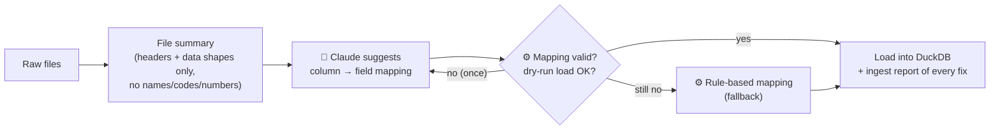
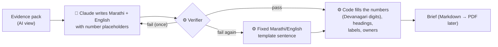
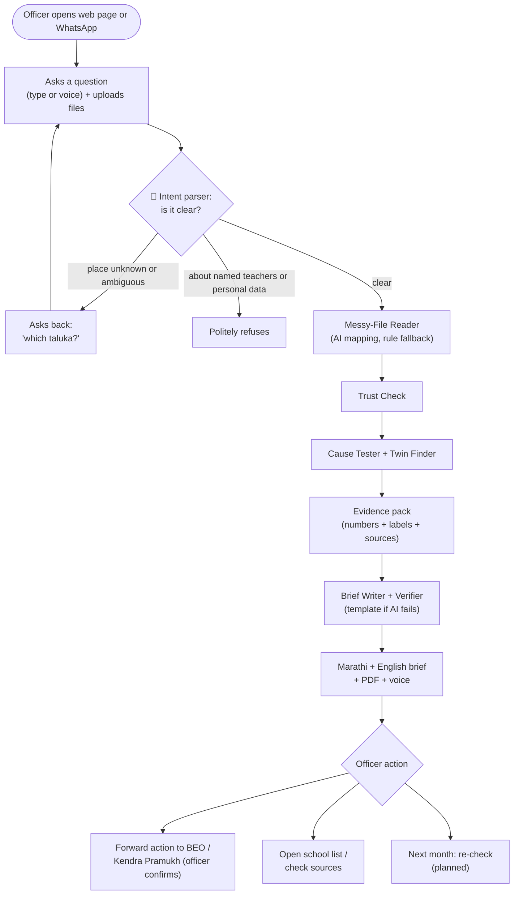

# Kaaran (कारण) — the whole project, in simple words

> Team EASY COMPANY · AI for Foundational Learning Hackathon (ShikshaNext × Anthropic), Challenge 4 "Data to Action"
> Status on **24 Oct 2026**: Phases 1–3 done (data, engines, AI layers). Build deadline **1 Nov 2026**.
> All demo data is **SYNTHETIC** (made up on purpose). Nothing here is a real finding about a real place.

---

## 1. Problem (one line)

Block and district education officers have plenty of data in messy Excel/PDF files, but no analyst and no time to turn it into *"what went wrong, why, and what do I do on Monday?"*.

## 2. Solution (three lines)

1. The officer asks a question in Marathi (for example *"पंढरपूरचा गणिताचा निकाल का घसरला?"*, "Why did Pandharpur fall in maths?") and gives the files the office already has.
2. Kaaran cleans and joins the files, checks whether the data can be trusted, tests the likely causes and finds a similar block that did better. **Every number is computed by code, not by AI.**
3. It returns a one-page **Marathi Evidence Brief** (English too), with a confidence label on every point and actions the officer can take. A voice summary is planned.

---

## 3. System architecture

### 3.1 The whole system

```mermaid
flowchart LR
    U["👤 Officer<br/>(web page / WhatsApp)"] --> Q["Question<br/>(Marathi or English)"]
    U --> F["Office files<br/>(Excel, CSV, PDF)"]
    Q --> IP["🤖 Intent parser<br/>which taluka? what question?"]
    F --> MR["🤖+⚙️ Messy-File Reader<br/>AI suggests column mapping,<br/>code checks and loads"]
    MR --> DB[("DuckDB store<br/>clean tables + source row<br/>for every value")]
    DB --> TC["⚙️ Trust Check<br/>fake / missing / odd data"]
    TC --> CT["⚙️ Cause Tester<br/>vacancy, election duty,<br/>infrastructure, attendance"]
    TC --> TW["⚙️ Twin Finder<br/>similar block that did better"]
    IP --> CT
    CT --> CR["⚙️ Confidence rules<br/>STRONG / WEAK / …"]
    TW --> CR
    CR --> EP["📦 Evidence pack<br/>numbers + labels + source<br/>(no sentences)"]
    EP --> BW["🤖 Brief Writer<br/>writes sentences with<br/>placeholders, no numbers"]
    BW --> VF["⚙️ Verifier<br/>no invented numbers,<br/>no wrong 'cause' words"]
    VF --> OUT["📄 Marathi + English brief<br/>(web / PDF / WhatsApp)"]
```



🤖 = uses Claude (AI)   ⚙️ = plain code (deterministic, same answer every time)

**The key idea:** AI is used only where it is strong (reading messy headers, understanding a Marathi question, writing plain Marathi). Code does everything that must be exactly right (numbers, labels, checks).

### 3.2 Part by part (the important pieces)

#### A. Synthetic data generator (`src/kaaran/synth`)
- **What:** builds a fake but realistic district: 11 talukas, 1,292 schools, 5 school years, 7 messy files.
- **Why:** real school-level data is not public, and we need a known answer to test against.
- **How:** it "plants" 8 known truths (see §4.2) and adds real-life mess (spelling variants, lost zeros, duplicates). Same seed gives exactly the same files.

#### B. Messy-File Reader (`src/kaaran/ingest` + `src/kaaran/llm/mapper.py`)



- Finds the header row, maps columns such as *"Shala UDISE Kramank"* or *"यूडायस कोड"* to `udise_code`, fixes spellings, years, Marathi yes/no values, duplicates, negative vacancies and dates.
- Every loaded value keeps its **source**: file, sheet/page, row.
- Joins the attendance PDF to schools through a code list, then by name matching when a code is missing.

#### C. Trust Check (`src/kaaran/trust`)
- Flags **impossible data**: 100% attendance for 3+ months in a row, sudden jumps, too many missing months or years.
- Raises a **red flag** when such schools are concentrated in one taluka.
- **Protects honest schools:** low-but-natural attendance is marked "checked, fine", not flagged.
- Flagged data is **reported, never silently dropped**.

#### D. Cause Tester (`src/kaaran/causes`)
- **Trend:** did the taluka really fall? It uses a school-by-school test and requires the fall to hold across years.
- **Teacher vacancy:** do schools without a maths teacher fall more, and does that explain most of the drop?
- **Election duty:** did other talukas with the same heavy duty also fall? If not, the excuse is weak.
- **Infrastructure / attendance:** is there any link at all?

#### E. Twin Finder (`src/kaaran/twins`)
- Finds talukas similar to the focus taluka in size, enrolment and poverty, with the same election duty.
- Picks the most similar one that **improved**, and shows a "decoy" that is similar but did not improve.

#### F. Confidence rules (`src/kaaran/confidence.py`, `docs/CONFIDENCE_RULES.md`)
- Labels come from **written rules with fixed thresholds**, never from AI.
- STRONG = holds across years and against similar blocks. WEAK = a pattern, but similar blocks show it too. NOT ENOUGH DATA = data missing or unreliable. Also RED FLAG, LEARN FROM, NO LINK FOUND, CHECKED-FINE.

#### G. Evidence pack (`src/kaaran/evidence.py`, `docs/EVIDENCE_SCHEMA.md`)
- One JSON "contract" holding every number, label, entity and its source. It contains no sentences.
- The UI, the PDF and the Brief Writer read **only** this.
- A safe "AI view" removes school names and codes before anything goes to Claude.

#### H. Intent parser (`src/kaaran/llm/intent.py`)
- Turns a Marathi, English or transliterated question (typos are fine) into a plan: taluka, metric, question type.
- If the place is unknown or ambiguous, it **asks back** instead of guessing.
- It **refuses** requests about named teachers, personal data or off-topic things.

#### I. Brief Writer + Verifier (`src/kaaran/brief`)



- The verifier rejects: any digit typed by AI, unknown placeholders, cause words ("मुळे", "due to") on a non-STRONG point, school names, missing sections.

#### J. LLM layer (`src/kaaran/llm/client.py`)
- One small wrapper around Claude. It records every answer in `llm_cache/`, so tests and demos **replay for free and offline**.
- It logs tokens, cost and time per call, and stops live calls above a spend cap (default **$15**).

#### K. Eval harness (`src/kaaran/eval`)
- Runs the whole pipeline on the raw files and **scores it against the answer key**: truths found (x/8), false flags, invented numbers, mapping accuracy, intent accuracy, brief checks.

---

## 4. Data

### 4.1 What we use today
- **100% synthetic data** for the demo and all tests. It is marked "SYNTHETIC" in every file and every brief.
- **Why:** the data Kaaran needs most (school-level test scores, attendance, teacher posts with real UDISE codes) is **not public**. Synthetic data also gives us a known "answer key" to prove the engines work.

### 4.2 The synthetic district we built
- **District:** "SYNTHETIC DEMO DISTRICT", modelled on **Solapur (Maharashtra)**. Names can be switched to fully fictional ones with one config line.
- **Size:** 11 talukas (blocks), 1,292 schools, school years 2021-22 to 2025-26.
- **8 planted truths** (the answer key the engines must find):

| # | Planted truth (simple) | Expected label | Found? |
|---|---|---|---|
| T1 | Pandharpur really fell: rank 4th → 9th of 11 | STRONG | ✅ |
| T2 | "Election duty" excuse: 5 of 6 similar talukas did not fall | WEAK | ✅ |
| T3 | 11 schools without a maths teacher since 2023-24 explain ~2/3 of the fall | STRONG | ✅ |
| T4 | Malshiras is a similar taluka that improved (Sangola is the decoy) | LEARN FROM | ✅ |
| T5 | 23 Pandharpur schools show 100% attendance for 4 straight months | RED FLAG | ✅ |
| T6 | Mangalvedha: 46% of schools are missing data | NOT ENOUGH DATA | ✅ |
| T7 | Karmala has the worst infrastructure but did not fall | NO LINK FOUND | ✅ |
| T8 | 15 honest schools with low but natural attendance | NOT FLAGGED | ✅ |

- **Real-life mess added on purpose:**
  - taluka spelling variants (Pandharpur / Pandharpoor / पंढरपूर);
  - codes that lost their leading zeros;
  - title rows and merged cells;
  - Marathi headers;
  - year formats like 2023-24 / 23-24 / 2024, and subject spelled Maths / Math / गणित;
  - 2% duplicate rows;
  - negative "vacancy" numbers;
  - two date formats;
  - a 187-page attendance PDF with missing rows;
  - a code list covering only 97% of schools.
- **Hold-out layout `variant_b`:** the same data with headers reworded in English, Marathi and transliterated Marathi, shuffled columns, junk columns and renamed sheets. It tests that the AI reader works on layouts it has never seen.

### 4.3 Real data — where to get it (⏳ **not downloaded yet**)

| Dataset | Who publishes | Level | Access | Use in Kaaran |
|---|---|---|---|---|
| **PARAKH Rashtriya Sarvekshan 2024**: Solapur district report card ([list](https://parakh.ncert.gov.in/prs-reports-2024-districtlist), [Solapur PDF](https://parakh.ncert.gov.in/media/public_files/2025-08/Report_Solapur_IND27496.pdf)) | NCERT / MoE | District | Free PDF | **First real test.** District maths vs state vs India (e.g. Grade 3 maths: Solapur 75%, Maharashtra 64%, India 60%) |
| **NAS 2021** district report cards ([page](https://ncert.nic.in/DRC_2021.php?ln=en)) | NCERT | District | Free (big RAR of PDFs) | 2021 baseline. Not directly comparable with 2024, so it carries a caveat |
| **UDISE+** dashboard ([udiseplus.gov.in](https://udiseplus.gov.in/)), [Know Your School](https://kys.udiseplus.gov.in/) | Ministry of Education | National, state, district; KYS one school at a time | Free | Enrolment, teachers, infrastructure per taluka/school |
| **UDISE+ microdata** ([portal](https://microdata.udiseplus.gov.in/)) | Ministry of Education | School (pseudo IDs) | Registration with OTP | School-level patterns. Cannot be joined by real UDISE code |
| **PGI-D** (district grading) ([portal](https://dpgi.udiseplus.gov.in/)) | Ministry of Education | District | Free | Compare Solapur with similar districts (Solapur 2024-25: 364/600) |
| **ASER 2024** Maharashtra district estimates ([PDF](https://asercentre.org/wp-content/uploads/2022/12/Maharashtra_District-Estimates.pdf)) | ASER Centre | District (rural) | Free | Independent check on foundational learning |
| **Census 2011 block-wise PCA**, Solapur ([catalog](https://censusindia.gov.in/nada/index.php/catalog/41202)) | Census of India | **Block/taluka** and village | Free XLSX | Literacy, SC/ST share for the twin finder |
| **SECC 2011 via SHRUG** ([devdatalab.org/shrug](https://www.devdatalab.org/shrug)) | Development Data Lab | **Taluka** and village | Free CSV | Taluka-level poverty for the twin finder |
| **NITI Aayog MPI 2023** ([PDF](https://www.niti.gov.in/sites/default/files/2023-08/India-National-Multidimentional-Poverty-Index-2023.pdf)) | NITI Aayog | District | Free | District poverty context |
| **Election Commission** ([eci.gov.in](https://www.eci.gov.in/)), **State Election Commission** ([mahasec](https://mahasec.maharashtra.gov.in/)) | ECI / SEC | Constituency / taluka (dates) | Free | Real election windows (e.g. 7 May 2024, 20 Nov 2024) |
| **SCERT Maharashtra PAT** scores ([maa.ac.in](https://www.maa.ac.in/index.php?tcf=evaluation)) | SCERT Maharashtra | School / student | **Not public** (login) | **Core data for "why did maths fall"**. Needs an official request |
| **SARAL / VSK attendance** ([education.maharashtra.gov.in](https://education.maharashtra.gov.in/)) | Govt of Maharashtra | School / student | **Login only** | Real attendance. Ask the officer for an aggregated export |

**Biggest gap:** school-level PAT scores, attendance and teacher posts with real UDISE codes are not public.
**Plan:** a data request or letter of support from the Solapur ZP Education Officer (Primary) or BEO Pandharpur. Until then, the demo shows real **district** benchmarks (PRS 2024, NAS 2021, ASER, PGI-D) next to **synthetic** block data, clearly labelled.

**Rules for real data:** keep it in `data/real/` (git-ignored, never committed). Only totals and averages go to the AI.

---

## 5. Districts, blocks and documents (simple list)

**District:** Solapur-like demo district (Maharashtra), shown as "SYNTHETIC DEMO DISTRICT".

| Taluka (block) | Schools | Role in the demo story |
|---|---|---|
| **Pandharpur** | 140 | The focus: maths fell 56.0 → 52.7, rank 4 → 9; 11 schools without a maths teacher; 23 schools with fake-looking 100% attendance |
| **Malshiras** | 134 | The "twin": similar, but improved +6.5 (rank 8 → 3) |
| **Sangola** | 138 | The "decoy": similar, but did not improve |
| **Mangalvedha** | 100 | Too much missing data, so NOT ENOUGH DATA |
| **Karmala** | 116 | Worst infrastructure, but stable scores (infrastructure is not the cause) |
| **Akkalkot** | 117 | Dipped 1.5 in the election year for an unrelated reason |
| Barshi, Madha, Mohol | 121 / 118 / 108 | Had the same election duty, but did not fall |
| North Solapur, South Solapur | 92 / 108 | Ordinary talukas (a few vacancy schools for comparison) |

**Documents the office "uploads"** (7 raw files, all SYNTHETIC):

| File | Type | What is inside | Mess in it |
|---|---|---|---|
| `udise_2023.xlsx` | Excel, 3 sheets | School profile, enrolment, infrastructure | Title rows, merged cells, Marathi headers, codes as numbers |
| `attendance_jan-dec.pdf` | PDF, 187 pages | Monthly attendance per school, 2024 | Headers repeat, sections run over pages, ~1% rows missing |
| `crosswalk.xlsx` | Excel | Attendance short code → UDISE code | Covers only 97% of schools |
| `pat_scores.csv` | CSV | Std 3 maths scores per school per year | Mixed year formats, Maths/Math/गणित, 2% duplicates |
| `teacher_posts.xlsx` | Excel, 5 sheets | Sanctioned vs working teachers per subject | Negative "vacancy" numbers, 4 date formats |
| `election_duty.csv` | CSV | % of teachers on election duty per taluka/month | Two date formats |
| `taluka_profile.csv` | CSV | Poverty ratio per taluka | Percent instead of share, one misspelt taluka |

---

## 6. What the officer sees

### 6.1 On the web (Phase 4, being built)

```text
┌──────────────────────────────────────────────────────────────────┐
│  Kaaran कारण                         [ मराठी | English ]          │
│  ⚠ कृत्रिम (SYNTHETIC) डेमो डेटा — खरा निष्कर्ष नाही               │
├──────────────────────────────────────────────────────────────────┤
│  प्रश्न: [ पंढरपूरचा गणिताचा निकाल का घसरला?        ] 🎤          │
│  फाईल्स: [ udise_2023.xlsx ] [ pat_scores.csv ] [+ जोडा ]          │
│                                   [ अहवाल तयार करा ]               │
├──────────────────────────────────────────────────────────────────┤
│  पुरावा अहवाल: पंढरपूर                                            │
│  कल                        [ठाम पुरावा]                          │
│   २०२१-२२ ते २०२५-२६ मध्ये सरासरी गुण ५६.० वरून ५२.७;             │
│   क्रमांक ४ वरून ९.                                               │
│  निवडणूक कारण तपासले       [कमकुवत कारण]                          │
│  संभाव्य मुख्य कारण          [ठाम पुरावा]  → ११ शाळा (यादी ▸)       │
│  जुळा तालुका               [यांच्याकडून शिका]  माळशिरस             │
│  डेटा इशारा                [धोक्याची सूचना]  २३ शाळा (यादी ▸)      │
│  सुचवलेली कृती              ✔ DEO  ✔ BEO  ✔ केंद्रप्रमुख              │
│  [ PDF डाउनलोड ]  [ 🔊 आवाजात ऐका ]  [ स्रोत पहा ]                  │
└──────────────────────────────────────────────────────────────────┘
```

- Click any number to see its **source** (file, sheet/page, row).
- School lists ("यादी") come from code. They never go to the AI.

### 6.2 On WhatsApp (stretch goal, shown in the video)

```text
Officer:  🎤 (voice note, 12 s) "पंढरपूरचा गणिताचा निकाल का घसरला?"
Officer:  📎 udise_2023.xlsx   📎 pat_scores.csv   📎 attendance.pdf
Kaaran:   समजले ✅ पंढरपूर तालुका, गणित. फाईल्स तपासत आहे… (१-२ मिनिटे)
Kaaran:   📄 पुरावा_अहवाल_पंढरपूर.pdf
          (मराठी पहिले, English दुसरे · SYNTHETIC डेमो डेटा)
Kaaran:   🔊 (voice summary, ~1 min, Marathi)
Kaaran:   मुख्य कारण: ११ शाळांमध्ये गणित शिक्षक नाहीत [ठाम पुरावा].
          कृती: शिक्षक पुनर्नियुक्ती (DEO), माळशिरस अभ्यास भेट (BEO).
          अधिक तपशील? "शाळा यादी" लिहा.
```

---

## 7. User flow



If the AI is down, everything still works: rule-based mapping, rule-based question matching and a template brief.

---

## 8. Tech stack — what for, and why

| Feature | Tool | Why this |
|---|---|---|
| Language | **Python 3.11** | Best data libraries; one language for everything |
| Data cleaning and tables | **pandas**, **numpy** | Standard, fast, well known |
| Store with source tracking | **DuckDB** | A small SQL database in one file; no server to run; fast |
| Reading Excel / CSV | **openpyxl**, Python csv | Handles merged cells, title rows, Marathi text |
| Reading PDF | **pypdfium2** (fast), pdfplumber (tests) | pypdfium2 reads 187 pages in 0.3 s (pdfplumber takes 15 s) |
| Writing synthetic files | **reportlab**, openpyxl, **pyarrow** (parquet) | Realistic PDFs/Excel; files byte-identical for a given seed |
| Statistics | numpy (t-tests, correlations) | Simple, transparent; no heavy dependency |
| AI: file mapping, Marathi wording | **Claude Sonnet 5.5** (`claude-sonnet-5-5`) | Strong at messy headers and natural Marathi; ~$0.05 per call |
| AI: understanding the question | **Claude Haiku 5.5** (`claude-haiku-5-5`) | Fast and very cheap (~$0.0002 per question); 92% on our test set |
| AI connection | **Anthropic Python SDK 2.1** + our wrapper | Structured JSON output, retries, refusal fallback, spend cap, replay cache |
| Tests and evals | **pytest** (167 tests) + eval CLIs | Prove every planted truth; replay AI answers offline |
| Web demo (Phase 4) | **FastAPI** + simple HTML | Light; same Python code; easy to deploy |
| PDF brief (Phase 4) | HTML → PDF with **Noto Sans Devanagari** font | Correct Marathi rendering |
| Voice (planned) | **AI4Bharat IndicConformer** (speech→text), **Indic Parler-TTS** (text→speech); Bhashini / Google as backup | Indian-language models; can run locally so the audio stays on our server |
| WhatsApp (stretch) | **Meta WhatsApp Cloud API** (free test number) | Direct from Meta, no middleman; enough for the demo video |
| Code and history | **GitHub** | Judges inspect how AI is used |

---

## 9. Done so far, and what is left

### ✅ Done (Phases 1–3, 18–23 Oct)

| Phase | What we built | Proof |
|---|---|---|
| 1. Foundation | Synthetic district generator with 8 planted truths and 7 messy files | Same seed gives identical files; truths hold on 20+ seeds |
| 2. Deterministic engines | Ingest to DuckDB with sources, Trust Check, Cause Tester, Twin Finder, confidence rules, evidence pack, eval harness | **8/8 truths found on 5 seeds**, 0 false flags, 0 numbers without a source |
| 3. AI layers | Claude wrapper (cache, cost log, $15 cap), AI file mapper, intent parser, Marathi/English Brief Writer, verifier, guardrail tests | Mapping 100% (old rules: 0% on unseen layouts); intent 92–100%; briefs: **0 invented numbers**, ~$0.05 per brief; prompt injection ignored |

### ⏳ Remaining (24 Oct – 1 Nov)

| When | Task |
|---|---|
| 27–29 Oct | **Phase 4:** web demo (FastAPI), Devanagari one-page PDF, school drill-down, "click to see source" |
| 27–29 Oct | Voice: Marathi voice question → text, and a one-minute Marathi voice summary |
| by 28 Oct | **User testing** with an officer / teacher (scored by judges) + native-speaker review of the Marathi briefs |
| 28–29 Oct | Run **one real public dataset** (PRS 2024 Solapur PDF) through the pipeline; send the data request letter |
| 30 Oct | Hardening and deploy (public demo link) |
| 31 Oct | 3-minute YouTube video (with the WhatsApp segment) + 10-12-slide deck |
| 1 Nov | Submit (by afternoon) |
| Stretch | WhatsApp live channel, SMS fallback, action forwarding and next-month re-check, scanned-sheet reading |

---

## 10. WhatsApp integration (2 lines)

The officer sends a Marathi voice note and files to Kaaran's WhatsApp number. Meta's Cloud API calls our FastAPI webhook, and we download the media, turn the speech into text and run the same pipeline.
Within the 24-hour window we send back the PDF brief (document message) and a one-minute Marathi voice note (OGG/Opus, under 512 KB). After 24 hours we use an approved template message.

---

## 11. Why the answers can be trusted (guardrails)

1. **AI never makes numbers.** Every figure is computed by code and filled into the text by code.
2. **Every number has a source:** file, sheet/page, row. One click shows it.
3. **Labels come from written rules**, not from AI judgment ([`docs/CONFIDENCE_RULES.md`](CONFIDENCE_RULES.md)).
4. **"Associated with", not "caused by"**, unless the strict STRONG rules pass. The verifier blocks cause words otherwise.
5. **Bad data is flagged, never hidden;** honest low numbers are protected.
6. **Privacy:** school names, codes and personal data never go to the AI. Only totals and averages do.
7. **File contents are data, not instructions:** hidden "ignore your rules" text in a spreadsheet did not change anything (tested).
8. **Works without AI:** every AI step has a rule-based or template fallback.
9. **Demo data is SYNTHETIC** and says so on every page.

## 12. Key numbers (scorecard)

| Check | Result |
|---|---|
| Planted truths found (5 seeds, raw files only) | **8/8 every seed** |
| False flags / honest schools wrongly flagged | **0 / 0** |
| Numbers without a source | **0** |
| AI column mapping, unseen layout (3 seeds) | **100%** (rule-based: 0%) |
| Intent understanding (25 tricky questions) | Haiku **92%**, Sonnet **100%**, rules 88% |
| Brief sentences passing the verifier first time | **100%** (12/12 on 5 seeds) |
| Invented numbers in briefs | **0** |
| Cost per brief / time | **~$0.05 / ~18 s** |
| Automated tests | **167 passing** |

## 13. Cost so far
- Development budget target ≤ $180. Recorded so far: **$35** for Phases 1–2 (dev tooling), plus **$0.84** of live Claude API calls in Phase 3 (67 calls).
- Running cost per question: about **$0.05** (mapping, cached per file layout) + **$0.05** (brief) + **$0.0002** (intent).

## 14. Risks and open points
- **No real school-level data yet.** We need a data request to the Solapur ZP / BEO. Meanwhile we show real district benchmarks plus the synthetic demo.
- **User-testing evidence** is scored by judges and is still pending. It needs an officer or teacher session this week.
- **Marathi wording** needs native-speaker review (samples: [`data/samples/brief_seed42_mr.md`](../data/samples/brief_seed42_mr.md)).
- **Voice models** (AI4Bharat) are heavy. If they are too slow, use Bhashini or Google as a hosted fallback.
- **WhatsApp:** Meta's policy bans general chatbots. Kaaran is single-purpose and refuses off-topic requests, so it fits.

## 15. How judges' criteria are covered

| Criterion (weight) | How Kaaran answers it |
|---|---|
| Efficacy and user-centric (35%) | Marathi-first, voice-first, one page, actions within the officer's powers; user testing planned |
| AI use and technical depth (30%) | AI only where strong; verifier, fallbacks, cost cap, evals with answer keys, injection test |
| Innovation (25%) | "A data analyst, not a dashboard"; twin-block positive deviance; trust check that protects honest teachers |
| Roadmap (10%) | WhatsApp, real data via ZP/SCERT, monthly re-check, scanned sheets, review-meeting assistant |

## 16. Try it (commands, Windows)

```text
.venv\Scripts\python -m kaaran.synth --seed 42 --out data/synthetic/demo           # make the demo data
.venv\Scripts\python -m kaaran.analyze data/synthetic/demo/raw --focus Pandharpur --out evidence.json
.venv\Scripts\python -m kaaran.brief data/synthetic/demo/raw --focus Pandharpur --out-dir out   # Marathi + English brief
.venv\Scripts\python -m kaaran.eval --seed 42                                       # scorecard vs answer key
.venv\Scripts\python -m pytest -q -m "not slow"                                     # fast tests
```

More detail: [`docs/PROJECT_CONTEXT.md`](PROJECT_CONTEXT.md) · [`docs/SYNTHETIC_DATA_SPEC.md`](SYNTHETIC_DATA_SPEC.md) · [`docs/EVIDENCE_SCHEMA.md`](EVIDENCE_SCHEMA.md) · [`docs/CONFIDENCE_RULES.md`](CONFIDENCE_RULES.md) · [`PROGRESS.md`](../PROGRESS.md)
